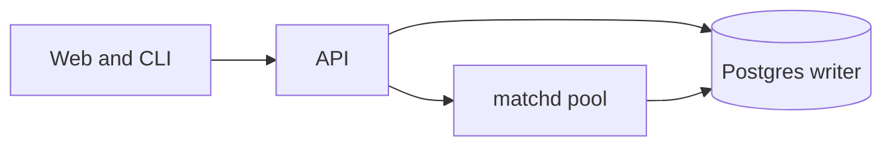
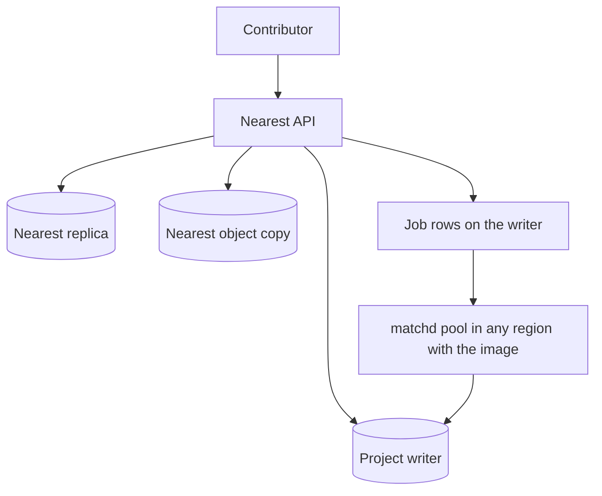

# re-hydra architecture

re-hydra coordinates reverse engineering one function at a time. A contributor checks out a chunk, translates it on their own machine, and submits source. matchd compiles that source and accepts it when the normalized bytes match the original function. The site stores claims and proof. It does not host a model, and it does not store provider API keys.

Local commands and Effect style live in [AGENTS.md](../AGENTS.md). What is built and what is next live in [roadmap.md](roadmap.md). The tables live in [db-schema/schema.md](db-schema/schema.md).

## What runs today

One site. One Postgres writer. The API and the web run on the host. matchd runs in Docker. Blob bytes live in `blob_objects`. Users talk only to the API. The API is the only caller of matchd.

| Piece | Today |
| --- | --- |
| Web | Vite app. Login, project board, checkout, submit, attempts, heartbeat, types, follows, integration builds |
| CLI | `hydra` login, checkout, submit, heartbeat, release |
| API | Effect HTTP API. Leases, attempts, proposals, the match worker, the link worker, the lease sweeper |
| Postgres | The only writer. Job rows stay here |
| matchd | One warm process per compiler image, plus extra copies when that image's interactive queue waits |
| Blobs | Content hashes in `blobs`. Bytes in `blob_objects` until object storage exists |

`projects.home_region` is filled in. Every project is homed on this one writer.

### Match queue

A submit inserts a `jobs` row and moves the chunk to `validating`. Several API workers claim with `FOR UPDATE SKIP LOCKED`, ordered by priority then age. `MATCHD_WORKERS` defaults to 4. A worker waits 2 seconds only when it found nothing to do. A claim expires after 2 minutes, which is longer than the 30 second compile cap, so a crashed claim can be run again. The result write still requires the chunk to be `validating` for that attempt.

Interactive jobs (`kind = 'interactive'`, priority 10) are claimed ahead of type-proposal rechecks (priority 100). Recipe rechecks, which rerun current matches after a language or flag change, live in `recipe_jobs`. Only one worker drains them, and only when no submit is waiting.

`MATCHD_URL` is the host-gcc process. `MATCHD_ROUTES` is `image=url` pairs. Several copies of one image are `url|url`. A job goes to the copy with the fewest compiles in flight. Unlisted images use `MATCHD_URL`.

`MATCHD_SCALE=docker` starts another local container of an image when an interactive job for that image has waited 30 seconds, up to `MATCHD_SCALE_MAX` (4). It removes that copy after the image has been idle for 60 seconds. The warm process stays up. `MATCHD_SCALE=off` leaves only the warm processes. The scaler only starts an image tag this repo already builds. It does not start a container for each submit.

### Compile

Each Docker image sets `MATCHD_SANDBOX=bwrap`. The compiler, assembler, and object tools run with no network, a read-only toolchain, and a private temp directory. Wall-clock time and CPU time each stop at 30 seconds. An output file stops at 32 MiB. A function source stops at 256 KiB. `types.h` stops at 2 MiB. Host `npm run matchd` leaves the sandbox off.

The digest recorded on a match is `sha256:v2:` plus the hashes of the compiler backend and the assembler, plus a hash of the recipe. GCC pins `cc1` or `cc1plus` and GNU `as`. `agbcc` pins its binary and `arm-none-eabi-as`. `mwcc` and Clang pin that compiler binary and leave the assembler half empty, because those compilers write the object themselves. A recheck that carries a v2 digest refuses a different binary. An older `sha256:` value is not a pin.

A registry image digest, a 512 MB resident cap, and a microVM are still later. The current sandbox shares the container kernel. Unknown relocations fail the match closed.

The link step is a separate worker and still uses host `gcc`. Isolated normalized match is the checkout success. Linking matched functions at their original addresses is an integration build, and a longer section fails even when the original bytes are a prefix of it.

## Product rules

1. The unit of work is a chunk. It defaults to one Ghidra function.
2. A chunk is done when matchd reports a normalized byte match. A whole-program link is a later build, and it is not the checkout gate.
3. Translation stays on the contributor's machine.
4. Functions match in parallel. A caller stays claimable while its callees are open.
5. When isolation is the wrong cut, a maintainer fuses those ranges into one chunk with one lease. Members leave the board.
6. The server stores a Ghidra export. It does not run the uploaded program, and it does not run Ghidra.
7. The owner pins one source language, compiler, version, and flags. A chunk may override the language. Changing the recipe invalidates matches and reruns them. Functions that still match stay matched.

### Normalized match

An isolated compile will not be bit-identical to the slice in the original file. Addresses, relocations, and padding depend on the original link.

- Compile the submission with the pinned recipe, as one translation unit.
- Take the entry symbol's bytes. Padding after the symbol is not part of the function.
- Blank relocation fields on the candidate and at the same offsets in the original bytes. Leave opcodes alone.
- The match succeeds when the two masked sequences have the same length and the same bytes. The score is equal bytes divided by original bytes.
- An unknown relocation fails closed.

The match row stores the toolchain digest, the type revision, the source hash, and the masked bytes. `original_insns` and `equal_insns` count those bytes.

### Lease

The live lock is columns on `chunks`. Checkout is one conditional update: the row must be open, or stale, and have no primary holder. Zero rows is a conflict. `validating` keeps the lease so a miss returns the chunk to the same person with the compiler text. A maintainer can clear a leased chunk and cannot clear a validating chunk.

The lease length defaults to 24 hours. Heartbeats extend it from the database clock, capped by `max_hold_hours` (48) measured from `hold_started_at`. One sweeper expires leases. Client clocks do not.

`max_concurrent_leases` defaults to 1. Values 2–8 allow extra holders in `chunk_leases`. One submission is `validating` at a time.

Submitting the same bytes again under the same lease returns the existing attempt.

### Types

Type headers are immutable revisions. A proposal points at a base revision and a new headers blob. Revalidation inserts one job per affected matched chunk. A compiler failure on that job leaves the match in place. When revalidation finishes and the project has a second owner or maintainer, the proposal waits in `ready` until a different privileged member accepts. One privileged member can land it alone. Accept writes a new revision. Membership is read when the proposal lands, not when it was opened.

An unresolved type moves the open and stale chunks that use it to `blocked`. Clearing it returns them to `open` or `stale`.

### Import and work bundle

The owner uploads JSON from their own Ghidra script. Chunk identity is the binary hash, the address range, and the hash of the raw bytes. Re-importing the same function refreshes pseudocode and does not open a second claim on bytes that are already leased or matched.

A checkout returns original bytes, disassembly, pseudocode, the pinned headers, callee signatures, the recipe, the best previous attempt when one exists, and `instructions.agent` for the contributor's agent. The pseudocode is a hint. Compiling it as-is will not reproduce the original bytes.

## matchd layout

Compilers are selected by `toolchain.image`.

- `apps/matchd/src/families/` — relocation widths for one CPU. Endianness lives on the target.
- `apps/matchd/src/toolchains/` — how a compiler binary is hashed.
- `apps/matchd/src/targets/` — one registered image: family, pin, object format, endianness, and the tools it runs.

An unknown image is refused. A console is a new family when the relocation names are new, a new toolchain file when the driver is not GCC, and a new target once a legally shippable compiler emits that object format. Nintendo, Sony, Microsoft, ARM, Metrowerks, and Hitachi SDKs are not installed. A public stand-in is a different binary from the retail SDK compiler, so a ROM built with the SDK will not match it. Handwritten assembly and coprocessor programs stay as bytes.

Which images are registered is the compiler section of [roadmap.md](roadmap.md).

ELF objects are read with `objdump -d -r`. COFF objects are read with `llvm-objdump`. COFF symbol tables store no size, so the function length is the disassembly up to the next symbol. `nm -S` sizes keep `T`, `t`, `D`, and `d`, which is how an ELFv1 function descriptor is printed.

## Data

Postgres is the schema in [db-schema/schema.md](db-schema/schema.md). Accounts, membership, chunk state, leases, attempts, revisions, matches, and job rows are writer data. Two writers must not update the same chunk.

`project_chunk_stats` is a cache. Refresh it with `ProjectChunkStats.refresh` on every chunk state change. Do not update the counts ad hoc. Reputation is computed: current matches minus `proposal_regressions`. It is not a table.

`jobs.sources` stores path and content hash, not file text. The worker loads bytes from blobs.

Object storage, read replicas, and a compiler registry addressed by digest are the multi-site plan below. Local development uses `blob_objects` and the image tags in this repo.

## Later: more than one site

This part is design. It is not deployed. The local scaler is the one-site form of "add compile capacity when interactive wait exceeds 30 seconds." A second site is the next capacity step, and it waits until this site's pool is dull.

Move bytes and compiles toward the contributor. Keep the lease decision on a single writer for that project.

1. A chunk has one writer. A second writer can grant two leases.
2. The schema already carries `home_region`, a content-addressed blob key, and a job id.
3. The first multi-site step adds read replicas, replicated object storage, and a matchd pool in each new region. The database writer stays single.
4. The step after that gives each project a home region. Three homes cover the world. Further sites are for compile capacity, not for more writers.
5. Web and API processes stay stateless and may run in more cities than matchd. matchd runs only where a sandbox can run.
6. Compile inputs travel inside the job. A worker does not wait for blob replication before it compiles.
7. Lease expiry uses the database clock.
8. The person who just checked out a chunk sees the writer response. Everyone else's board may lag by the replica delay.

| Site | First multi-site step | Home region per project |
| --- | --- | --- |
| North America | Writer for every project, local reads, matchd pool, object bucket | Writer for projects homed here |
| Europe | Replica, matchd pool, object bucket | Writer for projects homed here |
| Asia Pacific | Replica, matchd pool, object bucket | Writer for projects homed here |

A fourth site answers queue wait or a community far from all three. It can be matchd-only.

Checkout still forwards the conditional update to the writer. The client renders that response and does not rediscover the lease from a replica. Work-bundle downloads use the content hash and a signed URL for the nearest bucket, falling back to the home bucket. A large export is uploaded to the home bucket. The importer parses it there.

Any pool that has the image can run a job. The result commits on the writer, and only if that attempt is still `validating`. Every region's sandbox policy is the same. Floating image tags are never the pin. The match record stores the digest.

Job rows stay in Postgres until claim traffic competes with lease writes. Scale a pool on interactive queue wait, target under 30 seconds, and keep a warm set so a single submit does not pay a cold start.

### Failure

| Failure | What continues | What pauses |
| --- | --- | --- |
| One matchd pool | Other pools claim the jobs | Compiles whose image exists only on the dead pool, until another pool has it |
| One read replica | Other replicas, and the writer | Local reads in that site |
| Nearest API | Other sites' APIs | Clients still pinned to the dead site |
| Object copy in one region | Fallback URL to the home bucket | Nearest-copy latency |
| The writer for a project | Replica reads, which may show stale leases | Checkout, submit, heartbeat, match commit, expiry |

A paused writer does not hand the lease to a second writer. Promoting a replica is a deliberate failover of that one home, with one sweeper afterward.

### Before a second site

- Two concurrent checkouts of one chunk produce one lease and one conflict.
- A duplicate job result does not create a second match or clear someone else's later lease.
- Expiry uses the database clock. A heartbeat cannot extend a hold past `max_hold_hours`.
- A worker without the image does not report a match from a different digest.
- Killing a matchd node mid-compile returns the job to the queue, and the later result still applies once.

## Out of scope

- Hosting a model, or storing provider API keys.
- Running Ghidra or the uploaded binary.
- Active-active lease updates.
- Checkout of individual basic blocks.
- Searching compiler flags automatically.
- Organizations, billing, and private projects.
- Treating a linked whole-image match as the checkout success state.
- Per-city matchd. Sandboxes stay in the few sites that can host them.

The owner who imports an export affirms they have the right to share that binary. A public launch still needs a written policy for copyrighted software and for malware.
