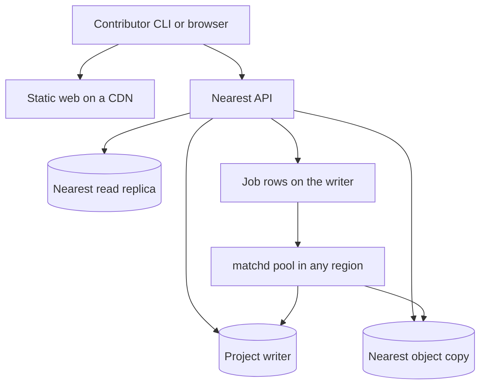

# re-hydra architecture and scaling

Status: design for multi-region scale. **Not implemented yet** — current deploy is a single local Postgres writer + local matchd (see [status.md](status.md)). Companion to [planning.md](planning.md).

The crowd is spread across the world. A checkout is rare and has to be exclusive. A compile is common, slow, and safe to run anywhere that has the pinned compiler image. Downloads of pseudocode and prior attempts are the bytes a contributor actually waits on.

**Move bytes and compiles toward the contributor. Keep the lease decision at a single writer for that project.**

## Decisions

1. A chunk has one writer. A second writer can grant two leases. Active-active updates of the lease row are out of the plan.
2. The first deployment is one site. The schema and APIs still carry a home region, a content-addressed blob key, and a job id, so later sites do not require a rewrite.
3. The first multi-region step adds read replicas, replicated object storage, and matchd pools. The database writer stays single.
4. The step after that gives each project a home region. Lease writes for that project go only to that home. Three homes are enough to cover the world. More sites are added for compile capacity, not for more writers.
5. Web and API processes are stateless and may run in more cities than matchd. matchd runs only where a microVM sandbox can run.
6. Compile inputs travel inside the job. A worker does not wait for blob replication before it compiles.
7. Lease expiry is computed from the database clock. Client clocks never decide whether a hold is still valid.
8. The person who just checked out a chunk sees the response from the writer. Everyone else's chunk board may lag by the replica delay.

## What is heavy, and what must be exact

| Work | How often | Where it must run |
| --- | --- | --- |
| Checkout, release, heartbeat, submit, match commit, lease expiry | A human action, or a sweeper | The single writer for that project |
| Compile and normalized compare | Every submit, and every function touched by a type proposal | Any matchd worker that has the toolchain image |
| Work-bundle download | Every checkout | Nearest object copy, falling back to the home copy |
| Project directory, profiles, chunk board | Page views | Nearest replica |
| Import parse | Once per export | The project's home |

A busy project is hundreds of people and tens or hundreds of thousands of functions. It is not a stream of checkouts. The writer stays small. The sandbox pool is the part that grows.

Planning estimates, for sizing rather than as a promise:

| Situation | Scale |
| --- | --- |
| 10,000 open leases, heartbeat every 15 minutes | About 11 updates per second on the writer |
| One interactive submit | One job, about 30 seconds of compile, plus queue wait |
| Type proposal touching 100,000 matched functions, 600 sandboxes across three regions | On the order of 80 minutes if each compile uses the full 30 second cap |
| 100,000 functions, tens of kilobytes of pseudocode and disassembly each | Single-digit to low tens of gigabytes of blobs for one binary |

Heartbeats every 15 minutes match a 24 hour lease. Shorter intervals add writer load and do not make the hold fairer. The 48 hour maximum hold is still enforced on the writer from `hold_started_at`.

## Shape

| Piece | Instances | State |
| --- | --- | --- |
| Web | CDN, many cities | None. Static assets |
| API | Several per region, behind latency-based DNS | None. Bearer token and lease token are the credentials |
| Postgres writer | One per project home | Chunks, leases, attempts, jobs, accounts |
| Postgres replica | One or more per region | Read models of the writer it follows |
| Object storage | One bucket per region, replication on | Immutable blobs |
| matchd | A pool per region that can host sandboxes | None, beyond a local cache of compiler images |
| Expiry sweeper | One leader on the writer | Claims expired leases |

The API is the only caller of matchd, as in the product plan. Users never receive a matchd address. Cross-region traffic between API, writer, and matchd stays on the provider backbone, authenticated with a short-lived service credential.

### Example of three sites

Names below are roles, not a cloud vendor.

| Site | Role at stage B | Role at stage C |
| --- | --- | --- |
| North America | Writer for every project, replica for local reads, matchd pool, object bucket | Writer for projects homed here |
| Europe | Replica, matchd pool, object bucket | Writer for projects homed here |
| Asia Pacific | Replica, matchd pool, object bucket | Writer for projects homed here |

A contributor in a city without a site uses the nearest of the three. A fourth site is a response to queue wait or to a community that is far from all three, after the first three are operating.

matchd needs KVM or an equivalent for Firecracker. Ordinary container hosts often cannot provide it. API containers can run in cities where matchd cannot. A region without a legal place to run the sandbox still serves reads, and its submits run on a matchd pool that has the image.

## Request paths

### Read a project

Latency-based DNS sends the browser or CLI to the nearest API. That API reads the local replica: project summary, chunk page, contributor list. Replica lag on the order of a second is acceptable here. The chunk list is keyset pagination by address, with cached counts for open, leased, validating, matched, stale, and blocked. The list query does not join attempt bodies.

Public directory pages may be cached at the edge for a few seconds. Checkout, submit, and anything that carries a lease token are `Cache-Control: private, no-store`.

### Checkout

The nearest API forwards the conditional update to the writer. The statement is the one in the product plan. Overlap rejection runs in that same transaction, with a range exclusion constraint on the binary's address spans, so a fused chunk and a neighboring function cannot both be leased.

The response comes from the writer. `201` includes the lease token and the work-bundle manifest. `409` means the chunk is no longer open. The client renders that response. It does not re-read the replica to discover whether the checkout worked.

### Download a work bundle

The manifest from the writer lists content hashes. The API returns signed URLs for the nearest bucket. If a hash is missing there, the URL points at the home bucket. Bundles are immutable for a given hash, so they can be cached. A new attempt or a new type revision is a new hash, not an overwrite.

Pseudocode, disassembly, original bytes, submitted sources, and canonical encodings live in object storage. Postgres keeps the hash, the size, and the state. A large Ghidra export is uploaded straight to the home bucket with a signed URL. The importer in the home region then parses it and inserts chunk rows. The API process does not hold the export in memory.

### Submit

1. The nearest API checks the lease token against the writer and stores the source blob in the home bucket.
2. The same transaction inserts an attempt and moves the chunk from `leased` to `validating`, only if the token still matches.
3. The transaction inserts a job row. The row contains the toolchain image digest, flags, language, entry symbol, original bytes, and the submission sources. Those inputs are small for one function. The worker can start without fetching replicated blobs.
4. A matchd worker claims the job, compiles, and returns the score, diagnostics, and toolchain digest.
5. The writer applies the result only if the chunk is still `validating` for that attempt. A retried delivery does not create a second match. A perfect score commits the match and clears the lease. Any other score returns the chunk to `leased` for the same user.

The idempotency key is the lease token plus the source hash. Submitting the same bytes again returns the existing attempt.

### Heartbeat and expiry

Heartbeat is an update on the writer: if the token matches and `now()` is still inside `max_hold_hours`, set `lease_expires_at` from `now()` plus the project lease length, capped by the max hold.

One sweeper, elected on the writer, runs the expiry transition. Sweepers in other regions would race the same rows. A replica never expires a lease.

### Type proposal

The proposal row is written on the home writer. Revalidation inserts many jobs at bulk priority. Workers in any region with the image run them. The proposal stays open until every job has a recorded result. A dead worker's job becomes claimable again after its claim timeout. Interactive submits use a separate, higher-priority class. Each pool reserves a share of slots (start at one fifth) for interactive jobs so a 100,000-function revalidation cannot occupy every sandbox.

Per-user and per-project caps from the product plan still apply: one in-flight interactive job per user, and a project concurrency cap so one project cannot fill the reserved interactive slots.

## Data placement

### Writer data

Accounts, project membership, chunk state, lease columns, attempt metadata, type-revision metadata, match proofs, and job rows.

Chunk identity stays the binary hash, the address range, and the raw-byte hash, so two regions cannot invent two rows for the same function. Primary keys are UUIDs allocated by the API. Nothing uses a cross-region sequence.

`projects.home_region` is set when the project is created, to the site nearest the owner. At stage B every project is homed on the only writer, and the column is still filled in.

### Blobs

Keys are the content hash. Replication between regional buckets is asynchronous. Publishers write to the home bucket and treat that write as the durable copy. Other regions are caches with a fallback.

Compiler images are not blobs in this store. They live in a container registry, addressed by digest, and each matchd node pulls a digest on first use and keeps it on local disk. A job whose digest is absent in the nearest pool runs in another pool that already has it, or waits for the pull if that pool was chosen on purpose. Floating image tags are never used. The match record stores the digest, so a later revalidation runs the same bits.

### Search

Milestone 1 of the product can query the replica with ordinary filters. A dedicated index, fed by the writer, is worth adding when directory queries stop being cheap. The index is allowed to lag. Checkout is never served from it.

## matchd pools

Workers are horizontal and replaceable. A worker:

- claims one job with `FOR UPDATE SKIP LOCKED` on the writer, or the equivalent on a later queue
- starts a sandbox with no network, the caps from the product plan, and the pinned digest
- posts one result
- exits the claim

Claim timeout is longer than the compile cap (30 seconds of compile, plus pull time if the image was cold). A crashed worker loses the claim and another worker runs the same job. Determinism makes that safe: same digest, same inputs, same canonical result.

Scale the pool on queue wait, not on CPU average. Target under 30 seconds of wait for an interactive job when the region is healthy. Scale in when the queue is empty, leaving a small warm set so a single submit does not pay a cold cluster start. Image disk, not the API, is the idle cost.

Stage B can keep job rows in Postgres. Workers in every region claim from that one table. Job volume is "compiles in flight," which is hundreds or low thousands, not a message-bus problem. Move the queue to a separate bus only when claim traffic competes with lease writes. Results still commit on the writer either way.

Every region's sandbox policy is the same. A looser region would become the place submissions are sent.

## Growth path

### Stage A — one site

Ships with product milestone 1.

- One writer, one bucket, one matchd pool, API and web beside them.
- `home_region`, blob hashes, and job ids are already in the schema.
- Expiry sweeper runs next to the writer.
- This stage should be dull before the next one. The lease transaction, idempotent job result, and content-hashed blobs are the seams.

### Stage B — read and compile in three regions

Add when a second community is far from the writer, or interactive queue wait stays above target.

- Read replica and object bucket in each new region.
- matchd pool in each new region, on hosts that can run the sandbox.
- Latency-based DNS to the nearest API.
- Writer remains in the original site. Checkout from the far region pays one cross-region round trip. That cost is acceptable because checkout and heartbeat are infrequent. Bundle download and compile do not pay it on the heavy path.
- Adding a region is: bucket and replication, replica, matchd nodes and image cache, DNS, then a synthetic checkout against the writer and a synthetic job on the new pool. The sweeper stays on the writer.

### Stage C — a home region per project

Add when writer failover or write latency for far-away projects is no longer acceptable, or one writer's chunk table is too large to operate.

- A new project is homed at the nearest site to its owner. An owner can move a project when it has no `validating` chunks.
- The home writer is the only database that updates that project's chunks.
- The nearest API proxies lease and submit calls to the home. It serves the chunk board from a replica of that home.
- Accounts stay global, on one identity store replicated outward. Magic-link tokens are single-use and are consumed on the identity writer.
- A replica in each site carries enough of the other sites' public catalog for the directory. Membership and lease checks for a project are read from that project's home, not from the catalog.
- matchd is unchanged: any pool with the image can run a job, and the result is committed at the home.

Partitioning is by project. Two writers never update the same chunk.

### Stage D — more compile capacity

Add matchd machines in an existing site when that site's interactive wait stays high. Add a fourth site when distance or a full pool justifies it. A new site can be matchd-only and attach to stage B or C without becoming a project home.

## Failure

| Failure | What continues | What pauses |
| --- | --- | --- |
| One matchd pool | Other pools claim the jobs | Compiles that required an image cached only on the dead pool, until another pool pulls it |
| One read replica | Other replicas, and the writer | Local reads in that site, until DNS shifts |
| Nearest API | Other sites' APIs | Only the clients still pinned to the dead site |
| Object copy in one region | Fallback signed URL to the home bucket | Nearest-copy latency |
| The writer for a project | Replica reads of that project, which may show stale leases | Checkout, submit, heartbeat, match commit, expiry |

A paused writer does not hand the lease to a second writer. Promotion of a replica is a deliberate failover of that one home: stop writes, promote, move the DNS or proxy target, start one sweeper. Two promotions must not both believe they are the writer. Stage A and B rehearse this as a manual procedure. Stage C rehearses it per home.

Match commits that were in flight during the outage stay safe because the result write is conditional on attempt id and `validating`. After failover, workers retry results against the new writer.

## Invariants to test before a second site

- Two concurrent checkouts of one chunk produce one lease and one conflict.
- A duplicate job result does not create a second match or clear someone else's later lease.
- Expiry uses the database clock. A heartbeat with a skewed client clock cannot extend a hold past `max_hold_hours`.
- A client that reads a replica immediately after checkout still treats the writer response as the lease.
- A worker without the image does not report a match from a different digest.
- Killing a matchd node mid-compile returns the job to the queue, and the later result still applies once.

## Out of scope

- Active-active lease updates, conflict-free replicated chunk state, or "last write wins" on a chunk.
- Running Ghidra or the uploaded binary in any region.
- Per-city matchd. Cities get the web and, when useful, an API. Sandboxes stay in the few sites that can host them.
- A multi-region deploy as a requirement of product milestone 1. Stage A is the first production. The seams above are the requirement.

## Open questions

- Which three sites come first depends on where the earliest projects and contributors actually are. The roles in this document do not depend on the choice.
- At stage C, the identity store can stay the original writer or become its own small database. Either works. Splitting it is only worth doing when project shards move independently often enough to make a shared users table awkward.
- The interactive slot reserve (one fifth) and the 15 minute heartbeat are starting numbers. Change them from queue wait and writer load, not in advance.
