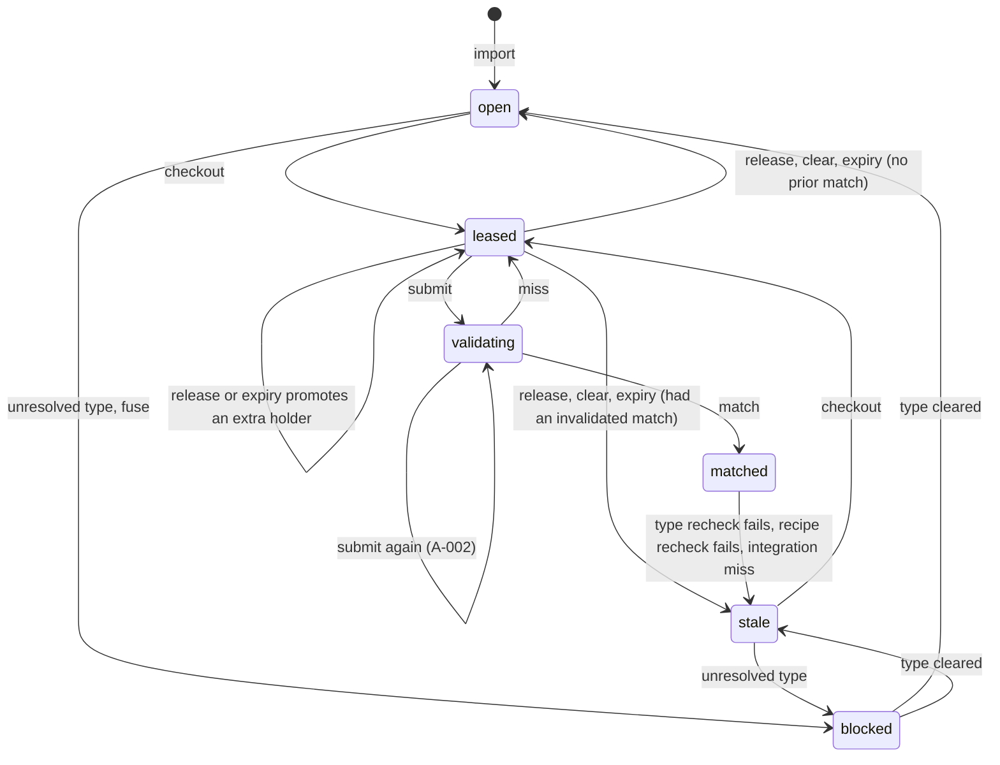

# Audit phases 1–2: purpose and architecture

Status: done 2026-11-22 against `main` at `cd2a88feb`. Phases from [plan.md](plan.md). Findings are logged in [findings.md](findings.md) as `A-xxx`.

Method: I read the docs, then the code for every chunk state write in `apps/api/src/services`, the migrations' constraints, the HTTP surface in `apps/api/src/Api.ts`, the web client (`apps/web/src/lib/api.ts`, pages), the CLI commands, and the matchd relocation tables. Nothing was run yet. Each finding is marked CONFIRMED (the code path can be read end to end) or PLAUSIBLE (needs a reproduction in phase 5 or 6).

**Update 2026-11-22:** A-001 to A-006 are fixed. The invariant table below is the state at audit time. The current state is in [plan.md](plan.md#progress) and the changes are in [changelog.md](changelog.md).

## Phase 1 — Purpose and product

### Product statement

re-hydra splits a binary into functions (chunks) taken from the owner's Ghidra export. A contributor takes an exclusive lease on one chunk, writes source on their own machine (usually with their own AI agent), and submits it. matchd compiles it with the project's pinned compiler and flags. The chunk is done when the compiled function's bytes equal the original's, ignoring relocation fields. The site keeps the lease, the attempts, and a proof record (`matches`). A later integration build links matched functions at their original addresses as a stronger check, but it does not gate the chunk.

The docs agree on this. `README.md`, `roadmap.md`, and `architecture.md` all tell the same story.

### What a match proves

A match proves that the compiled function has the same bytes as the original after masking the bytes each relocation covers, **using a public stand-in compiler**, not the retail SDK. It does not prove that:

- calls and data references point at the same targets (relocation targets are not compared, A-007);
- the opcodes are the same where a relocation covers a whole instruction (A-006);
- the function builds with the retail toolchain.

The product should state this in the UI and the FAQ. "Byte-perfect" in `README.md` overstates it.

### Personas and journeys

| Journey | API | Web | CLI | Gap |
| --- | --- | --- | --- | --- |
| Sign up, sign in, tokens | yes | yes | login with token | — |
| Create project, pin recipe | yes | yes | no | — |
| Import Ghidra export | yes | yes (`project.tsx:285`) | no | `roadmap.md` still says there is no web UI (A-017) |
| Add a maintainer or contributor, change a role | **no** | no | no | Only the creator is ever a member (A-011) |
| Archive or delete a project, remove a binary | no (`archived_at` exists, no endpoint) | no | no | No way to retire a bad import |
| Fuse, mark unresolved, clear lease, set chunk language | yes | yes | no | — |
| Check out, heartbeat, submit, release, attempts | yes | yes | yes | — |
| Propose types | yes | yes | no | — |
| Accept a proposal (second reviewer) | yes | yes | no | Unreachable: no project can get a second privileged member (A-011) |
| Start an integration build | yes | yes | no | — |
| Block or remove an abusive user | no | no | no | A-012 |

The biggest product gap: membership cannot be managed. Roles exist in the schema and the API checks them, but `project_members` is only written when a project is created (`ProjectsRepo.ts:265`) and by the seed. So:

- the two-person accept rule for type proposals never applies outside the seed;
- an owner cannot hand off maintenance;
- the `contributor` role is never granted. Everyone who isn't the owner works as an anonymous signed-in user.

### Incentives and abuse

- **Lease hoarding.** Any signed-in user can check out on any project (no membership check, A-012) and hold up to `max_held_chunks` (default 8, cap 32) for up to `max_hold_hours` (48). Ten accounts can freeze 80 chunks for two days. The only remedy is the owner clearing leases one at a time.
- **Reputation farming.** Reputation is current matches minus regressions. Small or empty functions (the `demo` fixture is a single `ret`) count the same as large ones. Weighting by `original_insns` would be cheap.
- **Proposal spam.** Proposals fan out a recheck job per affected matched chunk. Nothing limits how often one user can start them (phase 4).
- **Owner equals anyone.** Any account can create a project and become its owner, so owner-only powers are effectively available to every user on their own projects. The most important is the recipe: the compiler flags are an unvalidated string array (A-013).

### Legal and policy

Known open item: there is no written policy on copyrighted software or malware. Before a public launch it also needs: terms of use, a takedown contact and process, a license for submitted source (it is stored and shown to later contributors), and a rule for uploaded bytes that are malware (the server stores the bytes and serves them in work bundles).

### Success metrics

Nothing records time from checkout to match, queue wait over time, or matches per week, although `jobs` and `project_events` hold the raw data. Phase 7 should add these.

### Open product questions

1. Are projects meant to be open to every signed-in user, or should checkout require membership (with a self-join)?
2. Who appoints maintainers, and can an owner transfer ownership?
3. Should a whole-instruction relocation mask count as a match, or should matchd decode those instructions?
4. Should reputation be weighted by function size?

## Phase 2 — Architecture and design

### Invariants

Later phases cite these by number.

| # | Invariant | Enforced by |
| --- | --- | --- |
| I1 | At most one primary lease per chunk | Conditional `UPDATE` in `ChunksRepo.checkout`; `chunks` CHECK; `chunks_lease_token_uidx` |
| I2 | Extra holders ≤ `max_concurrent_leases − 1`, one per user | Code count (racy, A-009); `chunk_leases_user_active_uidx` for one per user |
| I3 | At most one submission `validating` per chunk | **Not enforced** (A-002) |
| I4 | A result commits only if the chunk is still `validating` for that attempt | Partly: the miss path checks `lease_token`, the match path does not, and the match row is written first (A-001) |
| I5 | At most one active match per chunk | `matches_one_active_per_chunk` |
| I6 | Lease expiry uses the database clock; heartbeat never extends past `max_hold_hours` | `LEAST(...)` in heartbeat; sweeper uses `now()`. Expiry takes effect at the next 30-second sweep (A-010) |
| I7 | A recheck never records a match from a different toolchain binary | `expectedToolchainDigest` sent when the current match has a v2 pin |
| I8 | A crashed claim is retried, and its result applies once | Claim expiry requeues; applies-once is **not** guaranteed (A-001) |
| I9 | Every chunk state change refreshes `project_chunk_stats` | Code convention; full recount outside the transaction (A-016) |
| I10 | No two active chunks overlap in one binary | `chunks_no_overlap` EXCLUDE constraint |
| I11 | A held chunk can always be returned to the pool by someone | **Not true for `validating`** (A-004) |
| I12 | A type proposal always reaches `ready`, `accepted`, or a failed state | **Not true** when a recheck compile fails (A-005) |

### Trust boundaries

| From → to | Authn | Authz | Input limits | Notes |
| --- | --- | --- | --- | --- |
| Browser, CLI → API | Session or access token (bearer) | Role checks only on owner and maintainer actions; checkout and submit need only a signed-in user | Not found yet (phase 4) | Any user can become an owner by creating a project |
| API → matchd | One shared bearer, default `dev-matchd-token` | None beyond the token | matchd caps source 256 KiB, `types.h` 2 MiB | Compare is not constant-time |
| matchd → compiler | — | — | bwrap: no network, read-only toolchain, 30 s, 32 MiB output | Flags come from the project owner, who can be any user (A-013) |
| API → Docker daemon | Local socket | — | — | Equivalent to root on the host |
| API → Postgres, S3 | Credentials in env | — | — | S3 key should be put and get on one bucket only |

### Chunk state machine (from the code)

The `chunks` CHECK constraint allows every state in this diagram. Two transitions are missing from the design:

- `validating` has no exit when its job fails before commit (A-004). Its CHECK row doesn't require `lease_expires_at`, and nothing sweeps it.
- `validating → validating` exists because submit accepts `state IN ('leased', 'validating')`, which the docs say cannot happen.

### Queues and workers

- **Match commit is not one transaction.** `MatchWorker` has no `withTransaction`. The interactive path updates the attempt, inserts the match, releases side leases, updates the chunk, refreshes stats, and marks the job, each as a separate statement. A crash or an error between them leaves partial state, and an error after the match insert turns the job into a retry loop: it stays `claimed`, is reclaimed every 2 minutes, and fails again on the unique index (A-001).
- **Submit is not one transaction.** It reads the lease without a lock, then writes the blob, attempt, state, and job separately. The job is inserted even when the move to `validating` touched no row (A-003).
- **Failures before compile** (`attempt missing`, `source blob missing`, `original bytes missing`) mark the job failed and leave the chunk `validating` (A-004).
- **Recipe rechecks** run only on worker 0 and only when no interactive job is queued. That is fair to submits, but a steady trickle of submits can delay rechecks with no bound. Low risk at today's scale.
- **matchd errors** become a miss with `toolchainDigest = "unavailable"`. During an outage contributors see misses, not "try again" (A-015).
- **Several API processes.** The sweeper and the workers are safe to run twice (row locks, `SKIP LOCKED`). The scaler is not: each process would start its own copies (A-018).

### Normalized match soundness

The rule is to blank every relocation field in the candidate and the same bytes in the original. Two weaknesses:

1. **Whole-instruction masks.** For PowerPC `REL24`, `REL14`, `ADDR14`, and `EMB_SDA21`, and for ARM Thumb `BL`, `MOVW`, and `MOVT`, the width is the whole instruction, so the opcode and registers are blanked too. A candidate `b` matches an original `bl` (only the LK bit differs). Under `EMB_SDA21` a candidate `stw` matches an original `lwz`. MIPS and AArch64 already mask by bit (`immediateBits`), which shows the fix (A-006).
2. **Targets are ignored.** A candidate that calls `foo` where the original calls `bar` matches. The integration build catches some of these, but it is optional. The export could carry each original call's target, so matchd could compare relocation symbol names (A-007).

### Multi-site design

The second-region design keeps one writer and is consistent with the invariants. Three points to settle before it is built:

- It relies on I4 and I8 ("the result commits on the writer, and only if that attempt is still `validating`"). Those don't hold today (A-001), and the cross-region latency and retries a second site adds make the race more likely.
- The scaler is per host. A pool in another region needs its own scaler, fed by queue wait for its images only.
- Replica reads of `chunks` will show leases the writer already expired. The design accepts this, but the web app's auto-heartbeat and conflict messages should be checked against a lagging board.

### Out of scope check

No code runs uploaded binaries, runs Ghidra, or stores provider API keys. `instructions.agent` in the work bundle is text for the contributor's own agent.

## Hand-off to later phases

- Phase 3: add constraints for I3 (a partial unique index on `attempts` or `jobs` for one unfinished interactive job per chunk) and I4. Revisit the `validating` CHECK row.
- Phase 4: A-013 makes owner-supplied flags a top sandbox test. Add an abuse test for lease hoarding.
- Phase 5: fix order is A-001, A-003, A-004, A-005, A-002, then A-006.
- Phase 6: each of A-001 to A-005 gets a reproduction test first.
