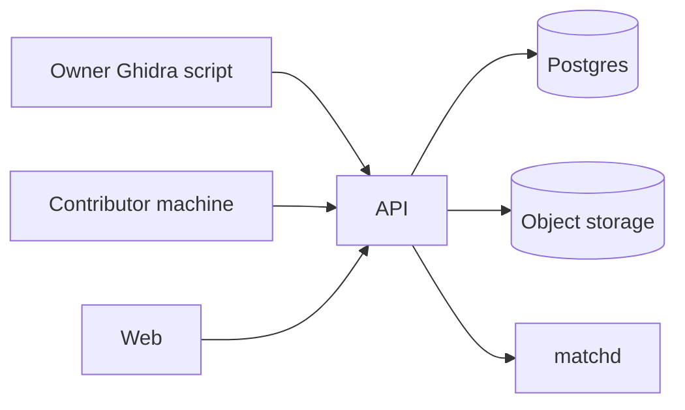

# re-hydra planning document

Status: product rules of record. **Implementation progress lives in [status.md](status.md)** (Milestones 1–4 done). This document still defines the product; do not treat anything past Milestone 4 as built.

re-hydra is a place to reverse engineer a binary the way the work actually happens: one function at a time, by many people. A contributor checks out a single chunk of Ghidra pseudocode, translates it with a model running on their own machine or on a subscription they already pay for, and submits source. A separate service compiles that source and accepts it only when the result matches the original function. People with small machines and cheap subscriptions can finish a binary that none of them could take on alone.

The site coordinates claims and proof. Translation stays on the contributor's side.

This sits next to existing decompilation communities. [decomp.me](https://decomp.me) already scores a function by compiling a scratch and diffing it against the original, and projects like pret coordinate matching by hand across GitHub and chat. re-hydra's difference is the claim: a chunk is checked out to one person so the same pseudocode is not being translated twice, and the work bundle is meant to be handed to a local model.

## Decisions

These are the recommendations the rest of the document argues for.

1. The unit of work is a **chunk**. It defaults to one Ghidra function. One person holds it at a time.
2. A chunk is done when **matchd**, a separate compile service, reports a normalized byte match. Matching the whole program image is a later step.
3. The contributor's model does the translation. re-hydra does not host models and does not store provider API keys.
4. Functions are matched **in parallel**. Shared types are versioned. A caller stays claimable while its callees are still open.
5. When isolation is the wrong boundary (inlining, or one source function split across ranges), a maintainer **fuses** those ranges into one chunk with one lease.
6. People find work through a project directory, a contributor list, and a user profile. The server stores a Ghidra export. It does not run the uploaded program, and it does not run Ghidra.
7. The owner pins **one source language** on the project, together with the compiler, version, and flags. Contributors submit in that language. A chunk may override it when that function was handwritten assembly or another language inside a mixed binary.

## What a contributor does

1. They open a project and take an open chunk.
2. The site hands them a work bundle: original bytes, disassembly, Ghidra pseudocode, the pinned type headers, callee signatures, the compiler recipe, and the best previous attempt if one exists.
3. They translate that bundle locally. A script can call a local model or their own hosted account. A browser paste is enough for the first version.
4. They submit source. The API refuses the submit unless the lease token is theirs.
5. matchd compiles it in a sandbox and returns a score plus compiler output.
6. A perfect normalized match commits the source to the project and frees the chunk. Anything short of that stays on the attempt, and the lease remains theirs so they can try again with the diagnostics.

The pseudocode is a hint. Ghidra's decompiler output is not source, and compiling it as-is will not reproduce the original bytes. The compiler output of the submitted source is the ground truth.

## What "byte perfect" means

A useful success test compares the function with itself, after the parts that move have been set aside.

An isolated function compiled in a sandbox will not be bit-identical to the slice in the original file. Absolute addresses, relocation entries, and padding depend on where the function sat in the original link. Treating raw file bytes as the test would fail correct source.

**Normalized byte match** is the chunk success state:

- Compile the submission with the project's pinned compiler, version, and flags, as a single translation unit.
- Locate the function symbol in the object file and take that symbol's bytes. Padding after the symbol is not part of the function.
- Read the object file's relocation records. Blank those fields on the candidate and at the same offsets in the original bytes. Leave every other byte, including opcodes, alone.
- The match succeeds when the two masked sequences have the same length and the same bytes. A longer or shorter candidate fails. The score is equal bytes divided by original bytes.
- An unknown relocation type fails the match closed. The integration build is what checks the real displacement.

The match record stores the toolchain digest, the flags, the type-environment revision, the source hash, and the masked bytes. The digest is `sha256:v2:` followed by the hash of the compiler backend (`cc1` or `cc1plus`), the hash of the assembler (`as`), and a hash of the recipe flags and language. A later revalidation refuses to compile when those binaries differ. A digest written before this pin is a version string; the next successful recheck with the same binaries replaces it. A flag change keeps the binaries and stores the new digest. `original_insns` and `equal_insns` on attempts written after the masked-byte change count those bytes.

A **whole-image match**, where linked bytes agree at the original addresses, belongs to a later integration build. It consumes functions that have already matched in isolation. It is not the gate on a single checkout. The linked section has to be the same length as the chunk. A longer section fails even when the chunk is a prefix of it.

The project owner sets the recipe at import: source language, compiler, version, and flags. Those four are one choice. The original bytes were produced by a particular compiler compiling a particular language, and a match is impossible under a different one. C compiled with GCC 4.8 will not reproduce the bytes of the same function written in Rust, or in C compiled with MSVC. Contributors do not pick a language on submit. The lease already names the language, and matchd compiles with that toolchain only.

Ghidra's pseudocode looks like C even when the program was C++, Delphi, or something else. That text is a hint for the model. It is not the language of the submission.

One language per project is the default because the binary was built once. A menu of allowed languages would let two people spend a lease on compilers that cannot hit the same bytes. Mixed binaries are handled with a per-chunk override: a C++ project can mark an `extern "C"` function as C, or a compiler-generated stub as assembly. The override is the exception, set by a maintainer, and that chunk's match record stores it.

Changing the project language, compiler, or flags invalidates existing matches. They were proven under the old recipe, and matchd re-runs them the same way a type proposal does. Functions that still match stay matched. The rest return to the pool.

Milestone 1 can compile C only, so C is the only language an owner can pin until later toolchains exist. The setting is still the owner's. Adding C++ later means shipping a compiler image and letting the owner select it, not a new checkout rule. Searching flag combinations can be added later; the first version trusts the recipe on the project.

## Exclusive checkout

Two people should not hold the same chunk. The lock is a lease row, updated in one transaction:

```sql
UPDATE chunks
SET state = 'leased',
    lease_user_id = $user,
    lease_token = $token,
    lease_expires_at = now() + ($lease_hours || ' hours')::interval,
    hold_started_at = COALESCE(hold_started_at, now())
WHERE id = $id
  AND state = 'open'
  AND lease_user_id IS NULL
RETURNING *;
```

Zero rows means someone else took it, or it is not open. The application returns that as a conflict, not as a second lease.

| State | Held by | Leaves when |
| --- | --- | --- |
| `open` | the pool | a checkout succeeds |
| `leased` | one user | submit, release, expiry, or a maintainer clearing it |
| `validating` | matchd | the job finishes |
| `matched` | the project | a type change breaks the match |
| `stale` | the project | a new match replaces it. Checkout leases it. Release, expiry, and a cleared lease return it to `stale` with the invalidated source attached. It stays out of the matched count |
| `blocked` | nobody | a maintainer clears an unresolved-type mark |

Rules that keep the lock fair:

- Default lease length is 24 hours (`lease_hours` on the project). Forgotten checkouts are the reason: a closed laptop should not sit on a chunk for days. A heartbeat from the open CLI or page extends the expiry, up to 24 hours from the heartbeat.
- A single hold cannot run past `max_hold_hours` (default 48), heartbeats included. That is enough for a weekend of active work, and not enough for an abandoned lease to stall the board. The best attempt stays attached, and the chunk returns to the pool. The same person may take it again only if it is still open.
- Release is explicit. Expiry is the same transition: the lease columns clear and attempts remain. A chunk with no invalidated match returns to `open`. A chunk whose match was invalidated returns to `stale`.
- A maintainer can clear a `leased` chunk. They cannot clear a chunk that is `validating`.
- Submit moves `leased` to `validating` only when the lease token matches. On a miss, state returns to `leased` for that same user, with the score and compiler text stored on the attempt. On a hit, state becomes `matched` and the source lands on the project.
- If a maintainer needs the chunk back during validation, they wait for the job. A perfect score still credits the person who submitted it.
- Address ranges inside one binary are an interval set. Checkout is rejected when the requested range overlaps an active lease or an existing fused chunk.
- While the lease is held, unsubmitted drafts stay on the contributor's machine. The server sees source at submit time. When the lease ends, attempts stay visible on the project so the next person inherits the highest score in their work bundle.

The first version is one lease per chunk. A later project setting can allow N competing attempts on a chunk for groups that want a race. The default stays exclusive, because duplicated model spend is the waste this product is built to avoid.

## Dependencies

Functions call each other, and they share structs, globals, and calling conventions. Those are different kinds of coupling, and only one of them should block a checkout.

### Match functions in parallel

A chunk is compiled alone and compared with its own original bytes. The call instructions are already in those bytes. The work bundle carries callee names and signatures from the current type environment, so the translation can emit a correct call while the callee is still open. A caller stays claimable the whole time.

Call-graph order is a sort on the work list. Leaves are easier, so they can sort first. Taking a caller early is allowed.

### Version the types, and re-check matches when they change

Struct layout, enums, typedefs, function signatures, and global declarations live in one project-wide type environment. Every lease and every match record pins a revision.

Someone who needs to change a struct opens a proposal, on the same terms as a pull request. Before it lands, matchd recompiles each matched function that uses the changed types.

- A function that still matches stays matched and is repinned to the new revision.
- A function that breaks becomes `stale` and returns to the pool with the previous source as the starting attempt. That source stays visible as the last invalidated match. The matched count does not include it.

Owners and maintainers are counted when the headers land. One privileged member can land a proposal alone. Two or more means two different privileged members: one starts revalidation, and another accepts after every job has finished, or immediately when nothing is matched. Two is the ceiling. The person who started revalidation cannot accept while two or more remain. If membership later drops to one, the remaining person can accept, including the person who started it. An author who is also a maintainer can be either of the two people. Failed functions do not block landing. The accept action shows that count. The revision is attributed to the proposal author. `reviewed_by` is the person who accepted.

The proposal can still land. The project sees the regression at review time. Signature drift, which is the usual reason people want to lock callers behind callees, is handled here.

Constants, vtables, and other data are imported as immutable bytes plus a declaration in the type environment. They are edited as types, or left as fixed bytes. They are not leased as code chunks.

A maintainer can mark a type unresolved when its layout is still a guess and a bad guess would poison codegen. Chunks that the export lists as using that type sit in `blocked` until the mark is cleared. This is a deliberate, rare block. New imports do not start blocked. Ghidra's inferred types are good enough to begin matching, and the first matches are evidence for later type proposals.

### Fuse chunks when one function is the wrong boundary

Ghidra's function list is the default slicing. Sometimes the original compiler inlined across that cut, or split one source function into several ranges. Isolated compilation will not reproduce an inlined body from a bare declaration: the sandbox would emit a call, and the original bytes contain the inlined instructions.

A maintainer fuses those ranges into one chunk. The fused chunk is one lease, one submission, and one compile. Overlapping checkouts of the members are refused. Fusing is the escape hatch for real coupling, applied to a known group, rather than a rule imposed on the whole call graph.

### Why callee-first locking is the wrong default

The other obvious rule is to keep a function unavailable until every function it calls has matched, and to walk inward from the leaves. It is easy to explain. It also leaves most of a binary unclaimable at the start, so the crowd cannot work at once. A six-function example (`main` calls `parse` and `emit`; those call `read`, `skip`, and `write`) has three claimable leaves and three functions sitting idle.

Parallel matching keeps all six claimable. Type proposals absorb signature changes. Fused chunks absorb inlining. Leaf-first remains available as a sort.

## Finding people and projects

The first version needs enough of a directory that a newcomer can locate a project and see who is already on it.

- Project list, filterable by name, architecture, and language, with percent matched and last activity.
- Project page: chunk board (open, leased, validating, matched, stale, blocked), contributor list, compiler recipe, and type-environment revision.
- User profile: display name, projects they maintain, chunks they have matched.
- Search by display name.

Follows, a site-wide activity feed, organizations, and reputation weights can wait. The contributor list and the profile cover "find a person, find their projects" for the first build. Reputation, when it exists, should count matched chunks and regressions introduced by type proposals, so a high score is tied to work that survived revalidation.

Permissions on a project are owner, maintainer, and contributor. Owners and maintainers import exports, edit the toolchain recipe, fuse chunks, mark types unresolved, and clear leases. Contributors check out open chunks and submit type proposals. Anyone can read a public project.

Public projects only, at first. Private projects add an access-control list before there is a second visibility mode to test.

## matchd

matchd is a separate deployable with no user sessions and no browser traffic. The API is its only client, authenticated with a service credential. It exists so that compiling untrusted source stays off the application servers, so compiler images can change without an API deploy, and so every match can be re-run later for a type proposal.

### Job

```http
POST /v1/jobs
Authorization: Bearer <service token>
```

```json
{
  "job_id": "uuid",
  "toolchain": { "image": "ghcr.io/re-hydra/gcc:4.8.5@sha256:…" },
  "flags": ["-c", "-O2"],
  "entry_symbol": "parse_header",
  "original": { "arch": "x86", "bytes_base64": "…" },
  "sources": [
    { "path": "candidate.c", "text": "…" },
    { "path": "types.h", "text": "…" }
  ]
}
```

```json
{
  "job_id": "uuid",
  "matched": false,
  "score": 0.86,
  "original_insns": 140,
  "equal_insns": 120,
  "compiler_ok": true,
  "diagnostics": "…",
  "toolchain_digest": "sha256:…"
}
```

`matched` is true only for a full normalized sequence match, as defined above. `diagnostics` is truncated and returned to the lease holder for the next attempt. The same inputs and the same `cc1`/`cc1plus` and `as` binaries must produce the same result. A job that names a different v2 compiler or assembler is refused before it compiles.

### Sandbox

Milestone 1 accepts C only. The job's language is the one pinned on the project, or the chunk override. The job is a file set, not a build script. The compiler's include path is the job directory only.

- No network.
- Wall clock around 30 seconds, memory around 512 MB, one compile at a time per job.
- Read-only toolchain image, writable temp directory, output size cap, source size cap.
- A microVM or equivalent isolation boundary (Firecracker or gVisor are the usual choices). Containers that share the host kernel are a weak boundary for this workload.
- One in-flight job per user, queued per project, so a single subscription cannot fill the pool.

The API stores the proof. matchd does not need the user database.

## System shape



| Piece | Role |
| --- | --- |
| Web | Project directory, chunk board, checkout, paste submit, scores |
| API | Accounts, leases, attempts, type proposals, search |
| Importer | Parses a Ghidra export into chunks and a type snapshot. No execution of the binary |
| matchd | Sandboxed compile and normalized compare |
| Postgres | Users, projects, chunks, leases, attempts, revisions |
| Object storage | Export blobs, submitted sources, canonical encodings |

The contributor can ignore the web after checkout. A thin CLI is part of the first milestone because the translation loop is local: checkout, read the bundle, call a model, submit, read the diagnostics.

```text
hydra checkout <project> <chunk>    # writes a work bundle directory
hydra submit path/to/candidate.c    # prints score and compiler text
hydra release <chunk>
```

### Import

The owner runs a script inside their own Ghidra. The server receives JSON, not a request to analyze a binary.

```json
{
  "binary_sha256": "…",
  "arch": "x86_64",
  "language": "c",
  "toolchain": { "compiler": "gcc", "version": "4.8.5", "flags": ["-O2"] },
  "types": "/* headers from the Ghidra type manager */",
  "functions": [
    {
      "name": "parse_header",
      "address": "0x401000",
      "size": 312,
      "bytes_sha256": "…",
      "bytes_base64": "…",
      "pseudocode": "…",
      "disassembly": "…",
      "callees": ["0x401200"],
      "types_used": ["Header"]
    }
  ]
}
```

Chunk identity is the binary hash plus the address range plus the hash of the raw bytes. Re-importing the same function updates pseudocode and does not open a second claim on bytes that are already leased or matched. Pseudocode is whatever the export contained. Refreshing it means the owner exports again after improving types in Ghidra. Server-side decompilation is out of scope.

### Work bundle

```text
chunk.json          address, size, arch, toolchain, byte hash
original.bin        raw function bytes
pseudocode.c        Ghidra decompiler text
disassembly.s
types.h             pinned type-environment revision
neighbors.json      callee names and signatures
attempt.c           highest-scoring prior submission, if any
```

### Records

```text
users
projects                      language, toolchain recipe, lease_hours, max_hold_hours
project_members               owner | maintainer | contributor
binaries
chunks                        range, byte hash, state, lease columns
attempts                      source hash, score, diagnostics, type revision
type_revisions                immutable snapshot per project
type_proposals                base revision, diff, revalidation result
matches                       attempt, toolchain digest, canonical hash
```

Chunk state and the lease columns live on `chunks` so the exclusive update stays a single row lock. `attempts` is append-only.

## Build order

See [status.md](status.md) for the live checklist. Summary:

### Milestone 1 — claim, translate, prove — **done**

- Accounts via email magic link. Public projects. Roles: owner, maintainer, contributor.
- Ghidra export import. Chunks default to one function.
- Exclusive lease, heartbeat, expiry, maintainer clear, overlap rejection.
- Project directory with name, architecture, and progress. Project page and a basic user profile with matched chunks.
- Web checkout and paste submit. CLI checkout, submit, and release against the same API.
- matchd with one pinned compiler image, normalized compare, stored proof.
- Previous attempts are attached to the next bundle when a lease ends.

### Milestone 2 — shared types — **done**

- Immutable type revisions and proposals.
- Revalidation of affected matches before a proposal lands. Regressions become `stale`.
- Fused chunks.
- Maintainer mark for unresolved types, which blocks only the chunks that use them.

### Milestone 3 — directory depth — **done**

- Follows and a per-project activity stream.
- Richer user search.
- A reputation signal based on surviving matches and type-proposal regressions.
- Optional project setting for N competing attempts on one chunk. The default stays 1.

### Milestone 4 — integration build — **done**

- Link matched functions and compare at original addresses.
- Failures name the chunks to reopen.
- Further languages (C++ next) as additional compiler images the owner can pin. The checkout rule stays the same.

## Chosen defaults

| Topic | Default |
| --- | --- |
| Accounts | Email magic link. Add another login when the directory needs it |
| Visibility | Public projects only |
| Source language | One per project, pinned by the owner. Milestone 1 supports C only. Per-chunk override for mixed binaries |
| Drafts | Off-server until submit. Attempts become visible when the lease ends |
| Lease | 24 hours, heartbeat extension, 48 hour max hold |
| Parallel claims | One per chunk, unless the project sets max concurrent leases from 2 to 8 |
| Call graph | Sort option, not a lock |

## Out of scope until a milestone says otherwise

- Hosting or proxying LLMs, and storing provider keys.
- Executing the uploaded binary, or running Ghidra on the server.
- Checkout of individual basic blocks.
- Automatic search over compiler flags.
- Organizations, billing, and private projects.
- Treating a linked whole-image match as the first success state.

## Upload policy

The owner who imports an export affirms they have the right to share that binary and to invite reconstruction. The server keeps the export and the function bytes the comparator needs. It does not execute the uploaded program. matchd executes only submitted source, inside the sandbox. The project owner can remove a project. A public launch still needs a written policy for copyrighted software and for malware; this document does not replace that policy.

## Open questions

These do not block milestone 1. They will need an answer before the milestone that touches them.

- When a fused chunk is later split, do the member matches restart, or is there a way to keep a member that already matched on its own?
